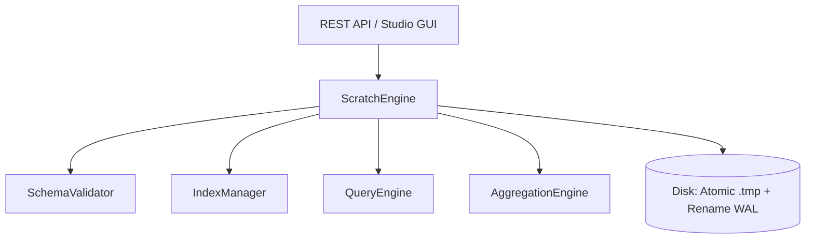

# ⚙️ Scratch NoSQL Database & Query Engine

A lightweight, standalone, MongoDB-compatible document database engine written from scratch in pure Node.js with zero native dependencies.

---

## 📑 Table of Contents
1. [Architecture Overview](#architecture-overview)
2. [Query Engine (`queryEngine.js`)](#query-engine-queryenginejs)
   - [Supported Query Operators](#supported-query-operators)
   - [Dot-Notation Field Access](#dot-notation-field-access)
   - [Projections](#projections)
   - [Multi-Field Sorting](#multi-field-sorting)
3. [Schema Validator (`schemaValidator.js`)](#schema-validator-schemavalidatorjs)
4. [Aggregation Pipeline Engine (`aggregationEngine.js`)](#aggregation-pipeline-engine-aggregationenginejs)
5. [Index Manager (`indexManager.js`)](#index-manager-indexmanagerjs)
6. [Core Storage & Atomic WAL (`scratchDb.js`)](#core-storage--atomic-wal-scratchdbjs)
7. [Usage Examples](#usage-examples)

---

## 🏛️ Architecture Overview

```
server/engine/
├── scratchDb.js          # Main engine orchestrator, file I/O & WAL persistence
├── queryEngine.js        # MongoDB-compatible filter, sort & projection evaluator
├── schemaValidator.js    # Strict / warn / dynamic schema & type enforcement
├── aggregationEngine.js  # Pipeline execution engine ($match, $group, $sort, etc.)
└── indexManager.js       # In-memory secondary and unique constraint indexes
```

The engine provides full MongoDB-compatible CRUD, aggregation, indexing, and schema validation with file-based persistence:



---

## 🔍 Query Engine (`queryEngine.js`)

The Query Engine is responsible for matching documents against MongoDB Query Language (MQL) filter specifications.

### Supported Query Operators

| Operator | Type | Description | Example |
| :--- | :--- | :--- | :--- |
| **`$eq`** | Comparison | Matches values that are equal (with deep comparison) | `{ "role": { "$eq": "admin" } }` |
| **`$ne`** | Comparison | Matches values that are not equal | `{ "status": { "$ne": "archived" } }` |
| **`$gt`** | Comparison | Greater than a specified value | `{ "price": { "$gt": 100 } }` |
| **`$gte`** | Comparison | Greater than or equal to a value | `{ "age": { "$gte": 18 } }` |
| **`$lt`** | Comparison | Less than a specified value | `{ "stock": { "$lt": 10 } }` |
| **`$lte`** | Comparison | Less than or equal to a value | `{ "rating": { "$lte": 3.5 } }` |
| **`$in`** | Comparison | Matches any value in an array | `{ "category": { "$in": ["Books", "Electronics"] } }` |
| **`$nin`** | Comparison | Matches none of the values in an array | `{ "tag": { "$nin": ["deprecated", "draft"] } }` |
| **`$regex`** | Evaluation | Matches string against a regular expression | `{ "email": { "$regex": "@gmail\\.com$", "$options": "i" } }` |
| **`$exists`** | Element | Checks for the presence of a field | `{ "discount": { "$exists": true } }` |
| **`$size`** | Array | Matches array length | `{ "tags": { "$size": 3 } }` |
| **`$all`** | Array | Matches arrays containing all listed elements | `{ "tags": { "$all": ["rgb", "gaming"] } }` |
| **`$elemMatch`** | Array | Matches arrays containing at least one matching item | `{ "items": { "$elemMatch": { "qty": { "$gt": 5 } } } }` |
| **`$and`** | Logical | Joins query clauses with a logical AND | `{ "$and": [{ "price": { "$lt": 50 } }, { "stock": { "$gt": 0 } }] }` |
| **`$or`** | Logical | Joins query clauses with a logical OR | `{ "$or": [{ "role": "admin" }, { "active": true }] }` |
| **`$nor`** | Logical | Joins query clauses with a logical NOR | `{ "$nor": [{ "banned": true }, { "age": { "$lt": 18 } }] }` |
| **`$not`** | Logical | Inverts the effect of a query expression | `{ "$not": { "role": "guest" } }` |

### Dot-Notation Field Access
The function `getNestedValue(obj, path)` traverses nested objects and sub-documents using dot notation:
```javascript
const doc = {
  profile: {
    address: {
      city: "San Francisco",
      zip: 94107
    }
  }
};

// Evaluates true:
matchesQuery(doc, { "profile.address.city": "San Francisco" });
matchesQuery(doc, { "profile.address.zip": { $gte: 90000 } });
```

### Projections
`projectDocument(doc, projection)` supports both inclusion and exclusion projections:
```javascript
// Inclusion projection: includes only title, price, and default _id
projectDocument(doc, { title: 1, price: 1 });

// Exclusion projection: omits password hash
projectDocument(userDoc, { passwordHash: 0 });

// Omit default _id
projectDocument(doc, { _id: 0, title: 1 });
```

### Multi-Field Sorting
`sortDocuments(documents, sortSpec)` sorts arrays of documents across multiple fields in ascending (`1`) or descending (`-1`) order:
```javascript
sortDocuments(docs, { category: 1, price: -1, createdAt: -1 });
```

---

## 🛡️ Schema Validator (`schemaValidator.js`)

Validates incoming documents against dynamic schema definitions before insertion or modification.

### Supported Field Types
- `string`, `number`, `boolean`, `date`, `array`, `object`, `objectId`, `any`

### Validation Rules
- `required`: boolean
- `unique`: boolean (automatically provisions a unique index in `indexManager`)
- `min` / `max`: minimum / maximum value for numbers; length for strings & arrays
- `pattern`: string regex pattern (e.g. email or UUID validation)
- `enum`: array of allowed values (e.g. `['admin', 'customer', 'vendor']`)
- `default`: default fallback value or `'now'` for current ISO timestamp
- `strict`: boolean — disallows unlisted fields when enabled

### Enforcement Modes
1. **`strict`**: Rejects invalid documents and halts insertion/update with descriptive errors.
2. **`warn`**: Allows document insertion but marks validation warnings.
3. **`disabled`**: Bypasses schema validation.

---

## 🔄 Aggregation Pipeline Engine (`aggregationEngine.js`)

Executes sequential data transformation stages:

```javascript
const pipeline = [
  { $match: { status: "completed" } },
  { $group: {
      _id: "$category",
      totalRevenue: { $sum: "$totalAmount" },
      avgOrderSize: { $avg: "$itemCount" },
      orderCount: { $count: {} }
  }},
  { $sort: { totalRevenue: -1 } },
  { $limit: 10 }
];

const results = executePipeline(orders, pipeline);
```

### Supported Stages
- **`$match`**: Filters documents using `matchesQuery()`.
- **`$group`**: Groups documents by `_id` and computes accumulator expressions:
  - `$sum`, `$avg`, `$min`, `$max`, `$count`, `$first`, `$last`, `$push`, `$addToSet`
- **`$project`**: Reshapes document fields.
- **`$sort`**: Sorts accumulated results.
- **`$limit`** & **`$skip`**: Paginates output.
- **`$count`**: Returns the total count of documents passing through the stage.
- **`$unwind`**: Deconstructs an array field from the input documents.

---

## 🗂️ Index Manager (`indexManager.js`)

Maintains in-memory secondary indexes for fast key lookups and enforces unique constraints:
- Automatically provisions `_id_` primary index.
- Automatically generates unique indexes for schema fields configured with `unique: true`.
- Rebuilds in-memory index maps on collection load or document changes.
- Prevents duplicate insertions by throwing a `Duplicate key error` with the conflicting key value.

---

## 💾 Core Storage & Atomic WAL (`scratchDb.js`)

### Atomic File Persistence
To prevent corrupt files during sudden restarts or power loss, writes are executed via write-ahead temporary files followed by atomic file renaming:
```javascript
_writeFileAtomic(filePath, data) {
  this.ensureDir(path.dirname(filePath));
  const tempPath = `${filePath}.${Date.now()}.${Math.random().toString(36).substring(2)}.tmp`;
  fs.writeFileSync(tempPath, JSON.stringify(data, null, 2), 'utf-8');
  fs.renameSync(tempPath, filePath);
}
```

### Directory Layout
Each database is a directory, and each collection is stored in a subfolder:
```
data/databases/
└── <database_name>/
    └── <collection_name>/
        ├── documents.json   # Documents array
        ├── schema.json      # Dynamic validation schema
        └── indexes.json     # Custom index definitions
```

---

## 💻 Direct Programmatic Usage

You can also use `ScratchEngine` directly in any Node.js application:

```javascript
const ScratchEngine = require('./server/engine/scratchDb');
const db = new ScratchEngine();

// 1. Create database & collection
db.createDatabase('shop_db');
db.createCollection('shop_db', 'products', {
  fields: {
    name: { type: 'string', required: true },
    price: { type: 'number', min: 0 }
  }
});

// 2. Insert document (ObjectId & timestamps generated automatically)
const product = db.insertOne('shop_db', 'products', {
  name: 'Mechanical Keyboard',
  price: 129.99
});
console.log('Inserted:', product);

// 3. Query documents
const results = db.find('shop_db', 'products', {
  filter: { price: { $gte: 100 } },
  sort: { price: -1 },
  limit: 10
});
console.log('Found:', results.documents);

// 4. Run aggregation
const agg = db.aggregate('shop_db', 'products', [
  { $group: { _id: null, avgPrice: { $avg: '$price' } } }
]);
console.log('Average price:', agg.result);
```
